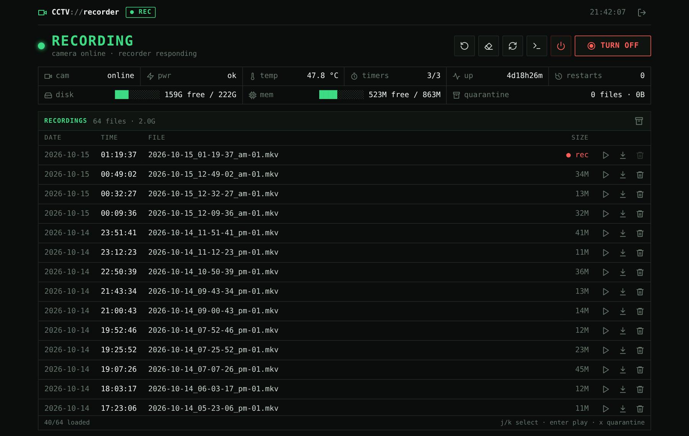
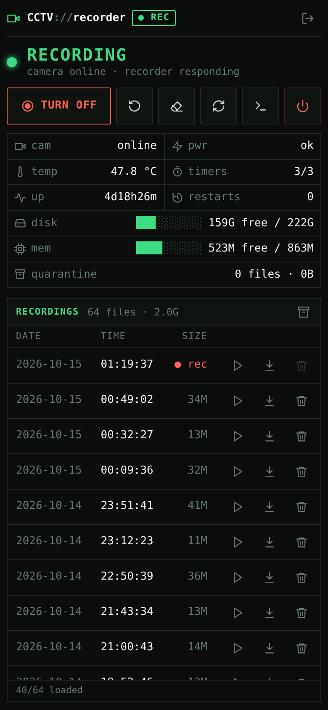

<div align="center">

# Raspberry Pi CCTV Control

**A private, motion-triggered CCTV recorder for a Raspberry Pi and one USB webcam.**<br>
Recordings stay on the Pi. Nothing is exposed to the Internet.

<p>
  
  &nbsp;&nbsp;
  
  &nbsp;&nbsp;
  
</p>

<br>

[](https://github.com/4riful/raspberry-pi-cctv-control/actions/workflows/ci.yml)


</div>

---

## Why

[motionEye](https://github.com/motioneye-project/motioneye) handles the camera well, but you can't run a recorder from it day to day. This project wraps it in a hardened install and adds a small HTTPS **control console** for the things you actually do:

- **See it's recording.** One loud state, plus camera, power, temperature, disk and memory at a glance.
- **Act in one tap.** Turn recording on or off, restart, run cleanup, read the service log, or power off the Pi.
- **Review footage.** Play in the browser, download, and delete safely: deletes go to a 24-hour quarantine you can restore from.
- **Forget about it.** Health checks every 2 minutes, hourly age and free-space retention, and crash recovery through systemd.

<div align="center">

</div>

<table>
<tr>
<td width="58%" valign="top">

### The console

- **One screen.** Only the recordings list scrolls.
- **Terminal look.** Monospace and dark, where colour only ever means state: green is live, amber is attention, red is stopped or destructive.
- **Light on the Pi.** About 40 KB total, no frameworks, no web fonts. It polls every 30 s and **stops when the tab is hidden**.
- **Works on a phone.** 44 px touch targets, notch-safe layout, no zoom when you tap an input.
- **Remembers you.** Sessions last 30 days, renew on each visit, and survive restarts and upgrades.

#### Keyboard

| Key | Action | Key | Action |
|---|---|---|---|
| <kbd>s</kbd> | recording on / off | <kbd>j</kbd> <kbd>k</kbd> | select recording |
| <kbd>r</kbd> | restart recorder | <kbd>Enter</kbd> | play selected |
| <kbd>c</kbd> | run cleanup | <kbd>x</kbd> | quarantine selected |
| <kbd>f</kbd> | refresh | <kbd>Q</kbd> | quarantine all |
| <kbd>l</kbd> | service log | <kbd>P</kbd> | power off the Pi |
| <kbd>q</kbd> | sign out | | |

</td>
<td width="42%" valign="top" align="center">



</td>
</tr>
</table>

## Quick start

> [!IMPORTANT]
> Mount your recording disk at `/var/lib/motion` **first**, and keep console or SSH access open during the first install. The installer never formats, partitions or mounts disks.

```bash
gh repo clone 4riful/raspberry-pi-cctv-control
cd raspberry-pi-cctv-control
sudo ./install.sh            # auto-detects the camera and private IP
sudo cctv-validate           # every check should say PASS
```

The installer prints the console URL and the path of a root-only file with freshly generated passwords:

```text
Installed successfully. CCTV Control: https://192.168.1.50:8443/
New credentials (root-only): /root/cctv-credentials-20261015T120000Z.txt
```

Open the URL, accept the self-signed certificate after confirming that the address is your Pi, and sign in. Then rotate the passwords with `sudo cctv-rotate-credentials`.

<details>
<summary><b>Installer options</b></summary>

```bash
sudo ./install.sh \
  --camera /dev/v4l/by-id/usb-YOUR_CAMERA-video-index0 \
  --camera-name Front-Door \
  --listen-address 192.168.1.50 \
  --retention-days 3 \
  --min-free-gib 8
```

| Flag | Default | Meaning |
|---|---|---|
| `--camera PATH` | first `by-id/*video-index0` | V4L2 capture device |
| `--camera-name NAME` | `Camera-1` | Display name (letters, digits, `.`, `-`, `_`) |
| `--listen-address IPV4` | default-route address | The one private address the console binds to |
| `--retention-days N` | `3` | Age ceiling for recordings |
| `--min-free-gib N` | `8` | Free-space reserve; the oldest clips go first |
| `--with-tailscale` | off | Install Tailscale and set up private tailnet access ([guide](docs/tailscale.md)) |
| `--accept-power-risk` | off | Continue despite undervoltage or throttling (lab use only) |
| `--allow-root-storage` | off | Allow recordings on the microSD (lab use only) |

</details>

<details>
<summary><b>What the installer changes</b></summary>

| Area | Change |
|---|---|
| APT | Motion, FFmpeg, Python venv, curl, CA certificates, OpenSSL |
| Python | `/opt/motioneye` from the pinned dependency lock |
| Config | `/etc/motioneye`, `/etc/cctv-control`, `/etc/default/raspberry-pi-cctv` |
| Services | `motioneye`, plus CCTV health, retention, control, helper and cleanup units |
| Accounts | Package account `motion`; locked system account `cctv-control` |
| TLS | Local ECDSA certificate and key, generated on the Pi |
| Credentials | Random passwords generated on the Pi; only hashes are stored |
| Backups | Replaced config copied to `/root/cctv-backups/TIMESTAMP/` |

It does **not** touch the OS release, kernel, firmware, bootloader, SSH, the firewall, router settings or public exposure.

</details>

## Hardware

| | Recommended | Notes |
|---|---|---|
| **Board** | Raspberry Pi 3 B+ or newer | Tested on 3 B+, Debian 13 arm64 |
| **Camera** | Any USB UVC webcam | Needs a stable `/dev/v4l/by-id/*video-index0` |
| **Power** | Official PSU and a short, thick cable | `vcgencmd get_throttled` must read `throttled=0x0` |
| **Storage** | Powered USB SSD, 256 GB or more | microSD works for testing but wears out |
| **Network** | DHCP reservation on your router | No port forwarding, ever |

> [!WARNING]
> Undervoltage is the most common cause of corrupt recordings and USB cameras dropping out, and software cannot fix it. The installer stops on a power warning, and the console shows one as an amber alert.

## How it works

```text
USB camera ─► Motion ◄── managed by motionEye (127.0.0.1:8765)
                │
                ├─► H.264/MKV clips ─► /var/lib/motion
                │                         ├── hourly age + free-space retention
                │                         └── .cctv-quarantine/  (24 h, restorable)
                └─► health check every 2 min

Browser ── HTTPS :8443 ─► cctv-control (unprivileged, no deps)
                              └── Unix socket, group-restricted
                                     └── cctv-control-helper (root, fixed actions only)
```

- **Loopback only.** motionEye, Motion control and the MJPEG stream never leave `127.0.0.1`.
- **One private address.** The console binds to exactly one private IPv4 address.
- **Fixed privileged actions.** The web process holds no privileges. It asks a root helper for actions from a fixed list (start, stop, restart, cleanup, quarantine, restore, power off) and can never send it a shell command.

## Security

| | |
|---|---|
| **Exposure** | No public listener. Optional Tailscale **Serve** (tailnet only); **Funnel** is never enabled. |
| **Auth** | PBKDF2 password hashes, `Secure` + `HttpOnly` + `SameSite=Strict` cookies, CSRF tokens, login throttling. Stored sessions are keyed by token hash. |
| **Browser** | Strict CSP, `X-Frame-Options: DENY`, `no-referrer`, authenticated media with range support. |
| **Destructive actions** | Nothing is erased immediately. Delete-all needs a typed phrase. Pi power-off needs `POWER OFF`. |
| **Sandboxing** | systemd filesystem, capability, device, namespace and memory/CPU limits on every unit. |

Read [SECURITY.md](SECURITY.md) before changing listeners or remote access.

## Storage planning

Recording is **motion-triggered**, not continuous. The retention age is a ceiling: when space runs low, the free-space reserve removes the oldest clips sooner. For worst-case continuous recording:

| Bitrate | Per day | 3 days | 7 days |
|---:|---:|---:|---:|
| 1 Mbit/s | 10.8 GB | 32.4 GB | 75.6 GB |
| 2 Mbit/s | 21.6 GB | 64.8 GB | 151.2 GB |
| 4 Mbit/s (default cap) | 43.2 GB | 129.6 GB | 302.4 GB |

256 GB is a practical minimum; 512 GB leaves headroom for busy days and quarantine.

## Operating it

```bash
sudo cctv-validate                                   # services, camera, dashboard, HTTPS
sudo systemctl list-timers 'cctv-*'                  # health, retention, quarantine purge
sudo journalctl -u motioneye -u cctv-control -n 100  # recent logs
sudo cctv-rotate-credentials                         # new passwords
```

**Upgrade:** `git pull --ff-only && sudo ./install.sh YOUR_OPTIONS && sudo cctv-validate`. Passwords, sessions and recordings are kept.<br>
**Remove:** `sudo ./uninstall.sh` removes the services but keeps all data and packages.

More in [docs/operations.md](docs/operations.md).

<details>
<summary><b>Ports you should see</b> (<code>ss -lntp</code>)</summary>

| Port | Bound to | Purpose |
|---|---|---|
| 7999 | `127.0.0.1` | Motion control |
| 8765 | `127.0.0.1` | motionEye |
| 9081 | `127.0.0.1` | MJPEG stream |
| 8443 | your private IPv4 | CCTV Control (HTTPS) |
| 443 | Tailscale address only | Private motionEye via Serve (optional) |

</details>

<details>
<summary><b>Troubleshooting</b></summary>

**`no stable V4L2 by-id index0 camera found`**: run `v4l2-ctl --list-devices`, then pass the node ending in `video-index0` with `--camera`.

**Installer stops on `throttled=…`**: use a properly rated supply, a short cable and powered USB storage, then fully power-cycle the Pi to clear the historical bits.

**Console won't open**: `sudo systemctl status cctv-control cctv-control-helper` and `curl -kI https://PI_ADDRESS:8443/`. Use the exact address chosen at install; the installer does not open firewall ports.

**A recording can't be deleted**: the clip still being written is marked <code>● rec</code> and can be removed about 3 minutes after the motion event ends.

**Blocky video or dropped frames**: check power first (`vcgencmd get_throttled`), then CPU load and USB errors. Don't lower the bitrate first.

**Tailscale connects but the browser doesn't**: the viewing device must run the Tailscale client on the same tailnet. Check that `tailscale serve status` says *tailnet only*.

</details>

<details>
<summary><b>Tested baseline and known limitations</b></summary>

| Component | Tested |
|---|---|
| Board / OS | Raspberry Pi 3 Model B+, Debian 13 (Trixie) arm64 |
| Python / Motion / motionEye | 3.13 / 4.7.x / 0.44.0 (isolated in `/opt/motioneye`) |
| Capture | UVC MJPEG 1280×720 at 10 FPS, H.264/MKV output |

These paths have been exercised on a live installation: capture and recording, motionEye playback, crash and restart recovery, retention, console login with CSRF, media range requests, quarantine and restore, and Tailscale Serve.

**Limitations:**
- Single camera only.
- The installer has not yet been run end to end on a freshly imaged second Pi.
- No automatic disk setup, firewall or SSH hardening.
- The certificate is self-signed.
- Some UVC/Motion combinations log non-monotonic DTS warnings even though the clips decode fine.
- Power and USB faults can't be fixed in software.

</details>

## Repository layout

```text
app/                 control console (Python stdlib) and fixed-action root helper
app/web/             dependency-free HTML / CSS / JS
docs/                operations, Tailscale, screenshots
scripts/             health, retention, validation, credential rotation
systemd/             hardened service and timer units
templates/           motionEye and Motion configuration
tests/               path-confinement and identifier boundary tests
install.sh           installer with preflight checks
uninstall.sh         non-destructive removal
```

## License

Copyright retained. No license is granted for redistribution unless one is added later.
